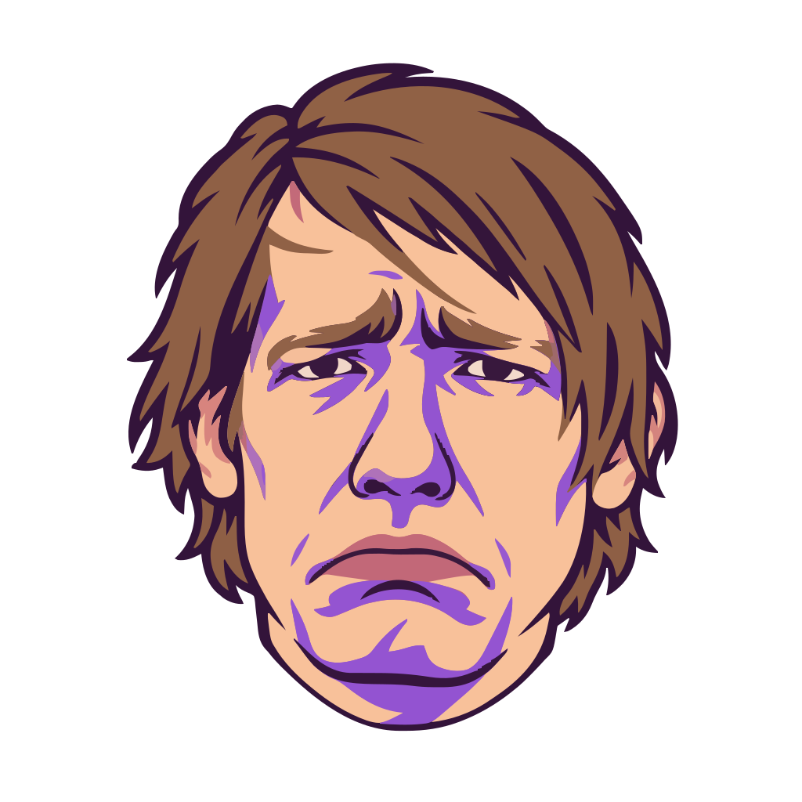
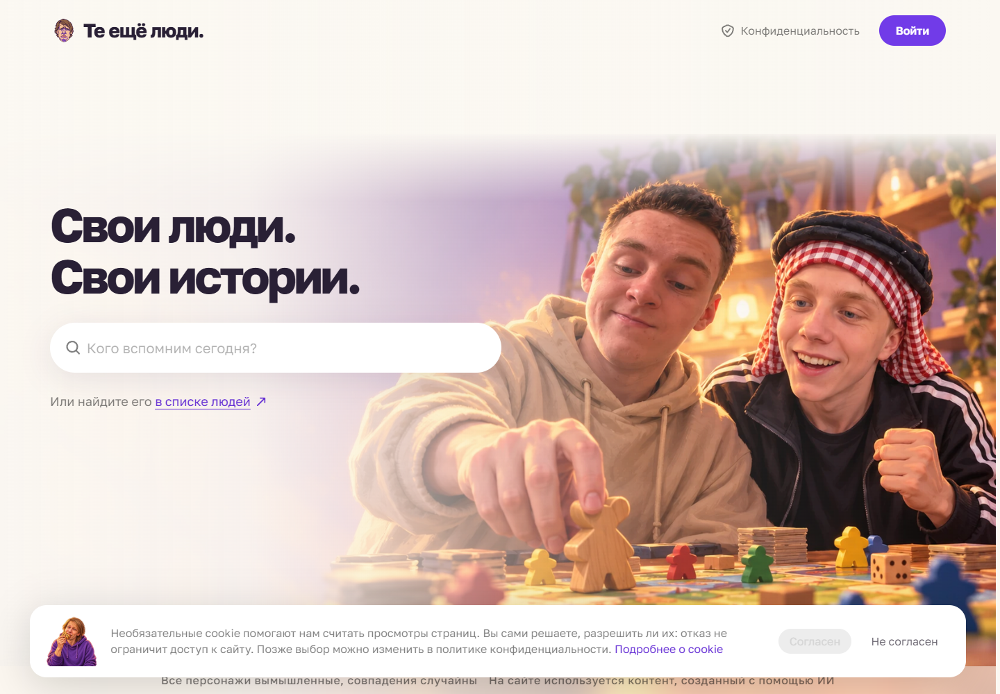
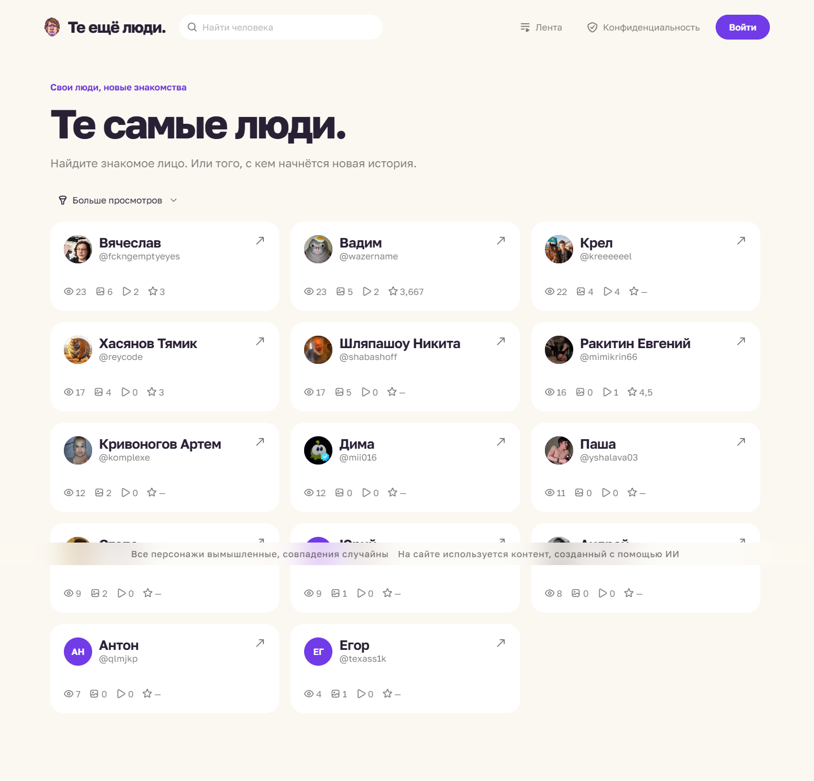
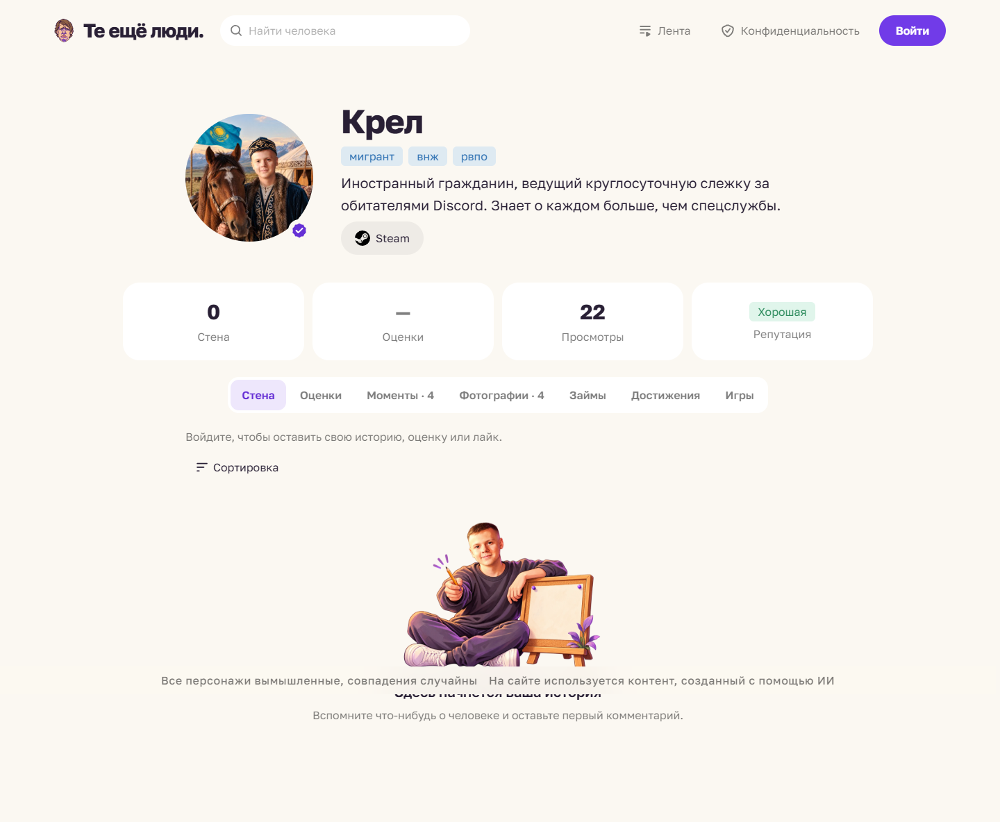
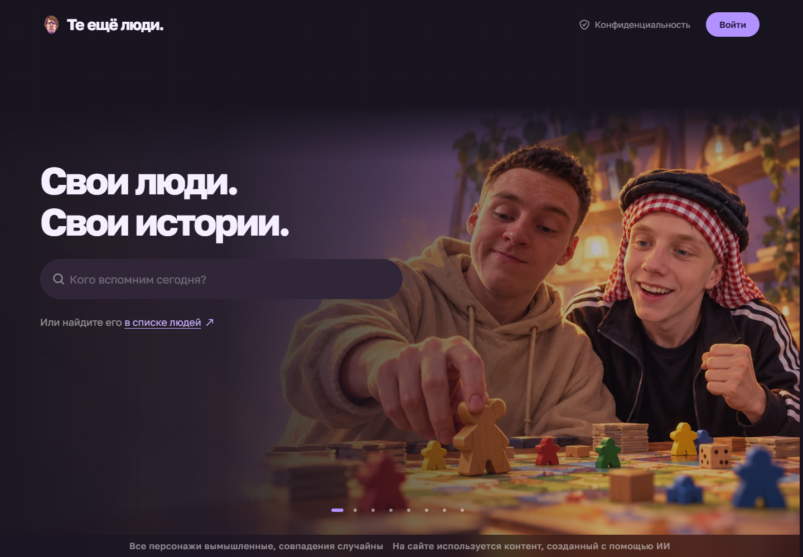
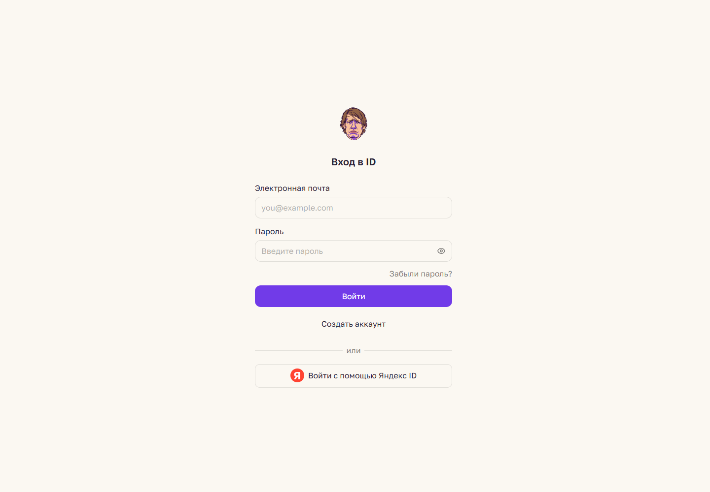
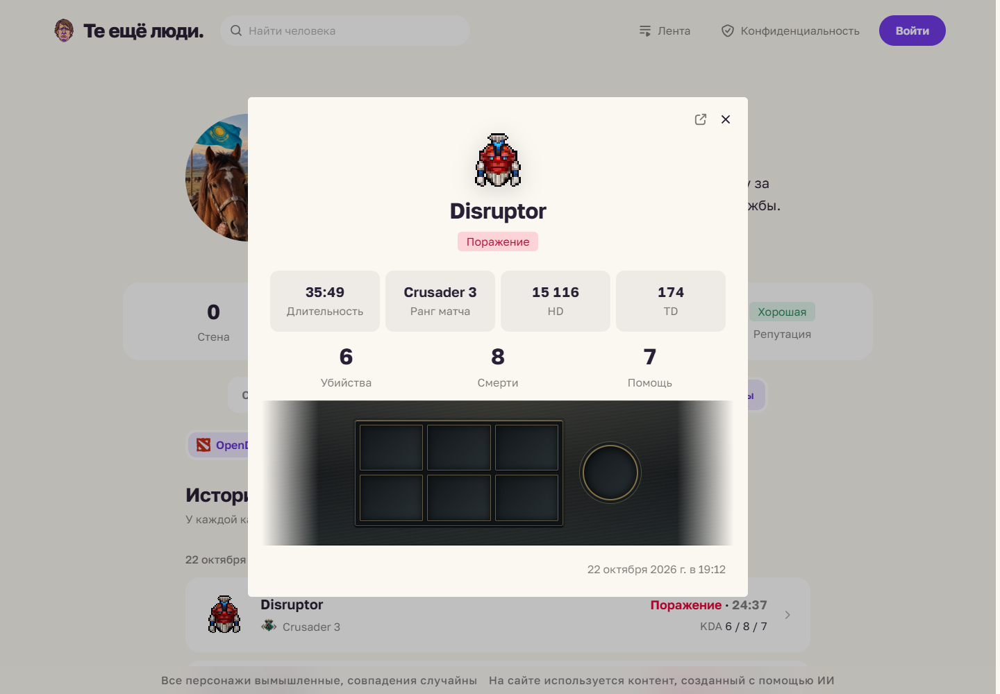
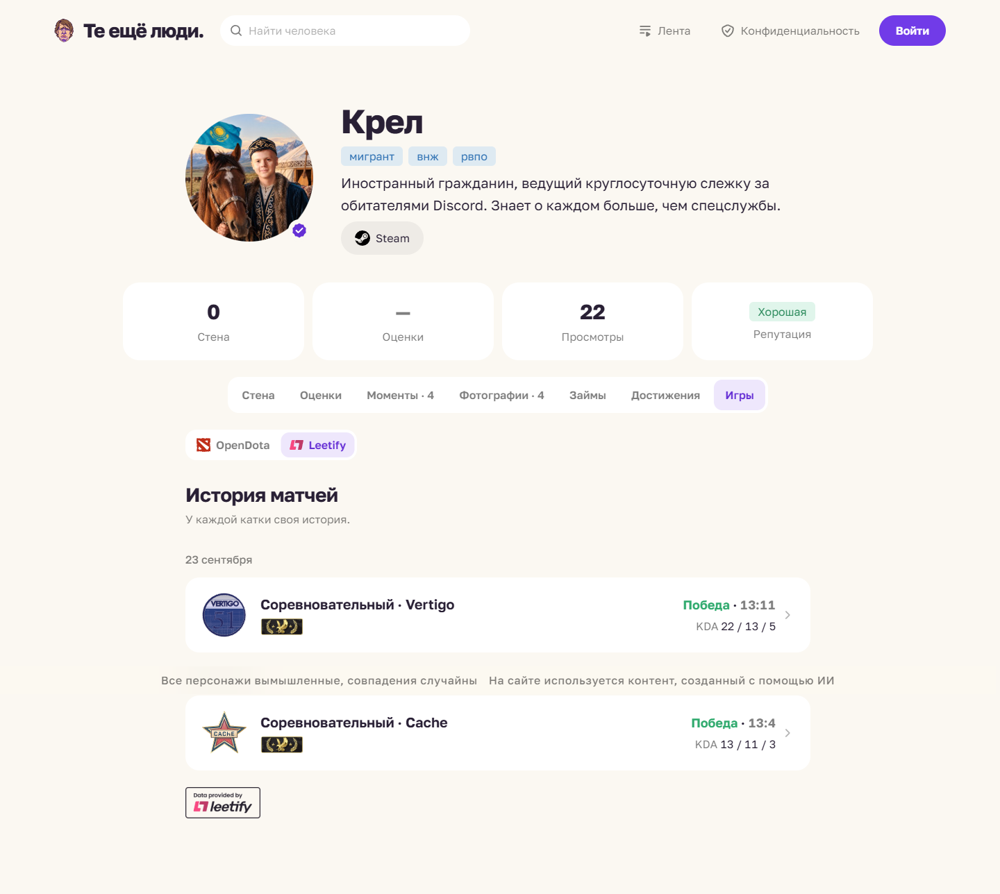
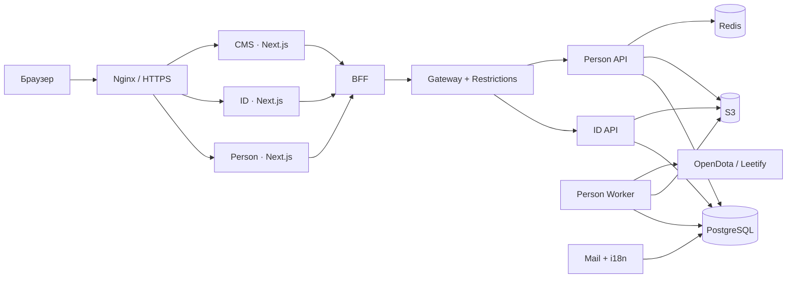

<div align="center">



# Те ещё люди

### Свои люди. Свои истории.

Страницы друзей, общие воспоминания, достижения и игровые истории.

[](docs/wiki/Archive.md)
[](backend)
[](frontend)
[](frontend/libs/ui)
[](frontend/libs/i18n)

[**Открыть сайт ↗**](https://kreeeeeel.ru) · [**Wiki**](docs/wiki/Home.md) · [**Возможности**](docs/wiki/Features.md) · [**Скриншоты**](docs/wiki/Screenshots.md) · [English](README_en.md)

</div>



## О проекте

«Те ещё люди» — небольшой социальный проект для компании друзей. У каждого человека есть своя страница: с историями на стене, фотографиями, моментами, отзывами и достижениями. Отдельные ID и CMS отвечают за аккаунты и управление сообществом.

**Разработка возобновлена 26 октября 2026 года.** Добавлены [даты профиля, армейский таймер, общая галерея и мобильная компоновка](docs/person/military-service_ru.md). Этот репозиторий содержит полную копию исходников; история компонентов и production CI остаются в [GitLab](https://gitlab.com/te-eshche-lyudi). Архивный релиз от 25 октября сохранён.

## Что умеет

| | Возможности |
| --- | --- |
| **Люди** | Поиск, каталог с сортировкой, персональные страницы, теги и социальные ссылки |
| **Истории** | Стена, оценки с отзывами и эмодзи, комментарии, реакции и лента |
| **Медиа** | Фотографии и видео, отметки людей, превью, просмотр и комментарии |
| **Сообщество** | Достижения, репутация, займы и запросы на привязку своей страницы |
| **Игры** | История Dota 2, карточки и детали матчей; импорт OpenDota по Steam-профилю; история CS2 и импорт Leetify |
| **ID** | Регистрация через почту, восстановление пароля, Яндекс ID, аватар и управление сеансами |
| **CMS** | Люди и аккаунты, роли, модерация, блокировки, достижения, настройки и журнал действий |
| **Интерфейс** | Русский и английский, светлая и тёмная темы, мобильная версия, reduced motion |

Подробности и границы реализации — в [каталоге возможностей](docs/wiki/Features.md). Настройки провайдера и внешний сервис влияют на доступность импорта матчей.

## Посмотреть

<table>
<tr>
<td width="50%"><br><b>Каталог сообщества</b></td>
<td width="50%"><br><b>Страница человека</b></td>
</tr>
<tr>
<td width="50%"><br><b>Тёмная тема</b></td>
<td width="50%"><br><b>Отдельный ID</b></td>
</tr>
<tr>
<td width="50%"><br><b>Dota 2 · OpenDota</b></td>
<td width="50%"><br><b>CS2 · Leetify</b></td>
</tr>
</table>

Скриншоты сделаны с действующего сайта 25 октября 2026 года, в отдельной анонимной сессии. [Галерея и мобильная версия →](docs/wiki/Screenshots.md)

## Как устроен



Kotlin, Spring Boot, Spring Data JPA, Flyway и OpenAPI на сервере; TypeScript, Next.js App Router, React, Gravity UI и CSS Modules на клиенте. Общие библиотеки предоставляют темы, локализацию, UI, редактор фото и динамические свойства. [Архитектура →](docs/wiki/Architecture.md)

## Запуск из публичного репозитория

```sh
git clone https://github.com/kreeeeeel/persons.git
cd persons
```

Все компоненты уже включены обычными файлами. Доступ к приватным GitLab submodules для этого checkout не нужен; `.gitmodules` сохранён как описание исходной структуры. Дальше выполните `./scripts/setup.ps1` в PowerShell или подготовьте `.env` по `.env.example` на Linux. Обычный запуск проекта: `docker compose up --build -d`. Это инструкция для самостоятельного восстановления, при архивировании локальное приложение не запускается.

Подробные требования, порты, генерация клиентов и проверки — [Getting Started](docs/wiki/Getting-Started.md) и [исходная инструкция разработки](DEVELOPMENT_ru.md).

## Навигация по Wiki

| Раздел | Содержание |
| --- | --- |
| [Главная](docs/wiki/Home.md) | Карта проекта и документации |
| [Возможности](docs/wiki/Features.md) | Пользовательские сценарии и ограничения |
| [Скриншоты](docs/wiki/Screenshots.md) | Живой интерфейс на desktop и mobile |
| [Архитектура](docs/wiki/Architecture.md) | Сервисы, библиотеки, контракты и данные |
| [Локальный запуск](docs/wiki/Getting-Started.md) | Подготовка окружения и проверки |
| [Эксплуатация](docs/wiki/Operations.md) | Production, хранилище, конфигурация и CI |
| [Игровые интеграции](docs/wiki/Integrations.md) | DotaBuff, Steam и динамические свойства |
| [Архив проекта](docs/wiki/Archive.md) | Происхождение среза и восстановление |

## Происхождение и права

[SOURCE_REVISIONS.json](SOURCE_REVISIONS.json) фиксирует точные GitLab-ревизии 19 исходных репозиториев. Публичная копия собрана из этих ревизий без изменения прикладной логики; оформление и текущие скриншоты добавлены при архивировании. Закрытые данные пользователей, дампы, runtime-секреты и исходные референсные фотографии в неё не включены.

Публикация исходников сама по себе не предоставляет отдельную open-source лицензию. В исходном проекте единой лицензии нет; права на сторонние зависимости, игровые изображения, шрифт и брендовые материалы остаются у соответствующих правообладателей. [Подробнее](docs/archive/RIGHTS.md).
