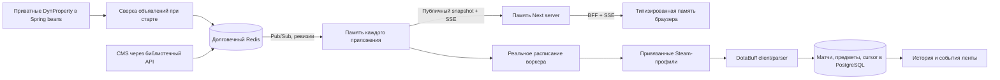

# Игровые интеграции и динамические свойства

## Границы модулей

- `backend/libs/dynamic-properties` владеет типизированными объявлениями, проверками, Redis, синхронизацией памяти, OpenAPI и административными контроллерами. В person нет собственного реестра или контроллера переменных.
- `frontend/libs/dynamic-properties` содержит React-провайдер, типизированные handles, серверное подключение и BFF. Адрес источника задаётся через `DYNAMIC_PROPERTIES_BASE_URL`; по умолчанию используется `PERSON_BASE_URL`.
- `backend/libs/dotabuff-integration` содержит автоконфигурацию клиента, HTTP, Steam ID resolver, HTML parser и доменные модели. В ней нет SQL или планировщика.
- `backend/person/app/maintenance` хранит матчи и предметы. API возвращает историю страницы и события ленты.
- `backend/person-worker`, пакеты `com.persons.personworker`, выбирает привязанные Steam-профили, владеет lease/cursor и запускает интеграции.
- Frontend `GameIntegration<Event>` задаёт загрузку, карточку, модалку и своё пустое состояние. `DotabuffIntegration implements GameIntegration<DotaMatch>` регистрируется в `gameIntegrations`. Общий `GameHistory` отвечает за пагинацию, loading/error/empty и открытие деталей. История и лента переиспользуют одну карточку и модалку.

Новые библиотеки находятся в основном workspace-репозитории; для них не нужен отдельный GitLab-репозиторий. CI проверяет их отдельно и учитывает их в графе зависимостей.



## Объявления и жизненный цикл

Потребитель Kotlin объявляет поле в обычном Spring bean:

```kotlin
private val rollout: DynProperty<Rollout> = DynPropertyFactory
    .createRolloutPercentageFeatureToggle("acquisition.offers.user.geo.api.percentage")
    .description("Процент использования User Geo API, 0–100")
    .build()

// Чтение не выполняет сетевых запросов:
val enabled = rollout.value.enabledFor(userId)
```

Библиотека обнаруживает приватные поля через BeanPostProcessor. До готовности приложения она подписывается на уведомления, сверяет объявления со scope `spring.application.name` и загружает значения в память. Обычное чтение `.value` не обращается к Redis.

Redis хранит определения, значения, ревизии и владельцев. Lua атомарно сохраняет изменение и публикует его. Устаревшая ревизия при редактировании даёт 409. При восстановлении подписки загружается полный snapshot, включая удаление пропущенных ключей. Периодического чтения Redis нет.

Snapshot и его общая ревизия читаются одной Lua-операцией. Удаления также получают ревизии. Реестр отбрасывает устаревшие снимки и уведомления, поэтому задержавшийся snapshot не удаляет более свежую переменную, а старое событие не возвращает удалённое значение. Начальный SSE snapshot и последующие рассылки сериализуются.

При старте:
- новые объявления добавляются с дефолтом;
- изменение типа, дефолта или схемы сбрасывает override к новому дефолту;
- изменение описания сохраняет override;
- удалённые из кода объявления удаляются только из своего scope; запись остаётся, если другой scope ещё владеет ею.

Поддержаны BOOLEAN, STRING, NUMBER, MAP, JSON, INSTANT, DURATION и ROLLOUT. Builder задаёт описание, публичность и схему проверки. Библиотека проверяет базовый тип, ограничения чисел/строк/массивов, локализованные структуры и форматы email/date-time/duration. Rollout использует стабильный SHA-256 bucket по идентификатору. Секреты в публичные свойства не помещаются.

Redis недоступен при старте — production-приложение не становится готовым с неактуальными дефолтами. Явное `dynamic-properties.storage=memory` используется только тестами и запрещено для prod/production.

При смене типа требуется согласовать версии потребителей: запущенный процесс со старым типом не может интерпретировать значение нового типа. Scope должен оставаться стабильным между перезапусками.

## Фронтенд

```typescript
export const gamesEnabled = DynPropertyFactory
    .createBoolean('frontend.person.games.enabled', true)
    .description('Показывать раздел «Игры»')
    .build();
```

Определения передаются библиотеке при подключении приложения. Backend-owned свойства объявляются через `.external()` и не регистрируются повторно фронтендом.

Next instrumentation и SSR вызывают одно идемпотентное `initialize()`. Регистрация frontend-owned определений выполняется сервером с сервисным JWT. В браузере этот маршрут закрыт. Разрешены только публичные frontend-ключи с префиксом `frontend.`. Сервер сохраняет публичный snapshot и слушает SSE. В браузер передаются только публичные значения; `useDynProperty(handle)` подписывает React-компонент на память библиотеки.

SSR сохраняет свой исходный snapshot отдельно от более свежего клиентского значения, чтобы гидрация не меняла разметку. После bootstrap обновления приходят по SSE; таймера опроса нет. При разрыве соединения сохраняется последнее значение, EventSource переподключается и получает полный snapshot. Пять секунд повторного соединения на Node применяются только после разрыва, не для опроса значений.

BFF проверяет Origin для изменений, передаёт пользовательскую сессию только административным запросам и добавляет сервисную авторизацию. Сервисные токены не попадают в bundle. Типизированный клиент и обработчик ошибок принадлежат библиотеке, включая 401/403/409.

## Хранилище и настройки

Compose добавляет отдельный `properties-redis` с AOF, `appendfsync everysec`, `noeviction` и томом `properties-redis`. Он не использует вытесняющий кэш ограничений доступа. Redis-порт локально — 6380; в production порт не публикуется.

Параметры подключения обрабатывает библиотека: `DYNAMIC_PROPERTIES_REDIS_HOST`, `DYNAMIC_PROPERTIES_REDIS_PORT`, `DYNAMIC_PROPERTIES_REDIS_PASSWORD`, `DYNAMIC_PROPERTIES_PREFIX`. Для frontend — `DYNAMIC_PROPERTIES_BASE_URL` (в Compose подходит общий gateway `http://gateway:8087/person`).

| Свойство | Дефолт | Поведение |
| --- | --- | --- |
| games.dotabuff.enabled | false | Включает импорт после согласования |
| games.dotabuff.importFrom | 2026-10-22T00:00:00Z | Нижняя граница импорта |
| games.dotabuff.pollIntervalSeconds | 300 | 60–86400 секунд |
| frontend.person.games.enabled | true | Показывает раздел «Игры» |
| site.marqueeEnabled, site.noticeTexts | объявления SiteSettingsService | Публичные настройки интерфейса |
| publication.*RequireModeration | true | Приватные правила модерации |

Существующие settings API сохранены для совместимости; данные читаются из typed handles. JPA-транзакция не откатывает Redis-настройку. Тесты явно очищают конфигурацию между сценариями.

## Планировщик и импорт

`GameSyncJob` получает Spring beans, реализующие `GameIntegration`. На готовности приложения каждому включённому провайдеру назначается обычное fixed-delay расписание с его текущим интервалом. Уведомление об изменении `games.<key>.*` отменяет будущее выполнение и назначает новое. Нет короткого такта, проверяющего время запуска. Один поток исключает пересечение старого и нового расписаний; JPA lease исключает одновременный импорт одной страницы разными репликами.

За запуск выбираются до пяти опубликованных, неудалённых страниц с привязанной сетью STEAM. Импортируется одна страница истории на профиль. Cursor сохраняется между запусками, поэтому бэкфилл идёт ограниченными порциями. Во время HTTP-запросов транзакция БД не удерживается.

Числовой SteamID64 преобразуется в account ID. Vanity URL разрешается обычным публичным XML Steam Community. Принимается только фиксированный HTTPS origin Steam; произвольные адреса профилей не загружаются. Клиент DotaBuff ограничивает частоту запросов, timeout и размер ответа, не следует redirect и явно возвращает 403/429/ошибки HTML.

Из истории выбираются матчи не старше importFrom/scanFrom, уже сохранённые пропускаются. Матчи, предметы и продвижение cursor фиксируются вместе после проверки lease и актуальной привязки Steam. Ключ `(person_id, match_id)` защищает от дубликатов. После полного прохода остаётся перекрытие в сутки для поздно появившихся матчей. Смена Steam URL или importFrom начинает проход заново, сохраняя уже импортированную историю.

При ошибке cursor не продвигается; сохраняются код ошибки и retry_at (Retry-After либо пять минут). Истечение lease позволяет другой реплике продолжить работу. Удаление/скрытие страницы исключает её из выборки и из публичной ленты; существующие матчи сохраняются.

## API и интерфейс

Контракт переменных находится в `backend/libs/dynamic-properties/contract/api/schema`; person подключает его ссылками. Клиенты генерируются, не редактируются вручную.

- GET /v1/admin/variables — все свойства, только ADMIN.
- PUT /v1/admin/variables/{key} — JSON-значение и ожидаемая ревизия.
- GET /v1/dynamic-properties/public — публичный снимок из памяти.
- GET /v1/dynamic-properties/events — SSE публичного снимка.
- PUT /v1/dynamic-properties/registrations/{scope} — серверная регистрация.
- GET /v1/persons/{id}/games/dota2/matches — история, page/size, максимум 60.
- GET /v1/games/dota2/events — события опубликованных страниц.

Карточка и иконка героя без обводки; у иконки нет подложки. Модалка показывает по центру пиксельную иконку, имя героя и тег результата. Затем идут длительность, ранг, урон героям/постройкам и KDA. Инвентарь — шесть слотов 3×2 и отдельная нейтралка на тёмной панели с прозрачными краями. На известных предметах показана минута получения. Внешняя ссылка находится слева от крестика, дата/время матча — справа снизу. Урон, нейтралка и acquisition clock опциональны в домене и контракте; отсутствие данных не заменяется выдуманными числами. V22 сохраняет эти данные в БД. Parser читает их только из явно распознанных полей; наличие в fixtures не гарантирует их доступность в текущей живой разметке DotaBuff.

Показатели модалки выровнены по центру: значение сверху, подпись снизу; урон сокращён до HD и TD с полной расшифровкой в title. Подпись нейтрального слота скрыта. Фильтр интеграций использует общий SegmentedTabs. Узкие табы прокручиваются без видимой полосы. Пустое состояние задаётся конкретным провайдером. В ленте внешний контейнер матча прозрачен; сверху — аватарка, имя страницы и серая подпись «сыграл матч в [иконка] Dota2 · время», ниже с отступом — общая карточка матча. Время использует общий ContentTime. Отступ шапки, вертикальные поля игровых событий и интервал между соседними игровыми событиями уменьшены в полтора раза.

Лента на главной была скрыта жёстким `showFeed={false}`; теперь ссылка видна авторизованному пользователю. Общая тема резервирует scrollbar gutter и компенсирует padding Floating UI при блокировке прокрутки модалкой.

## Проверка и ограничения

Unit/HTTP fixture-тесты проверяют parser, Steam URL и обработку отказов. Интеграционные тесты проверяют lease, cursor, дедупликацию, выдачу API и видимость страниц. Redis-тесты проверяют настоящие Lua/PubSub и автоконфигурацию; задайте REDIS_TEST_HOST/REDIS_TEST_PORT. Frontend проверяет bootstrap, SSE, хранение последнего значения, SSR snapshot, BFF, модалку и пустое состояние.

Production загружает Dota через публичный API OpenDota, потому что DotaBuff отвечает 403. Старый HTML-парсер остаётся только как независимая реализация; обходов защиты нет. История читается страницами по 100 матчей с offset, затем загружаются детали выбранного игрока и справочники героев/предметов. Курсор, lease, граница importFrom и дедупликация сохраняются. Отсутствующие показатели не выдумываются. Карточки и ссылки указывают OpenDota. Для совместимости настройки сохраняют префикс games.dotabuff. Поля описания в CMS указывают OpenDota. HTTPS использует TLS 1.2 с обычной проверкой сертификата и имени сервера. Apache HttpClient, версия которого закреплена BOM проекта, перебирает все адреса из DNS при ошибках TCP или TLS; недоступный адрес не блокирует рабочий. Подключение и handshake ограничены пятью секундами на адрес, чтение ответа — настройкой timeout провайдера. Размер ответа и интервалы запросов по-прежнему ограничены; 403/404/429 сохраняются как ошибки.

Общая лента использует серверный агрегатор `GET /v1/feed`: Dota/CS и существующие публикации участвуют в общей сортировке, фильтрации и пагинации без ограничения первыми записями каждого источника. См. [реальные данные каталога и ленты](../community-data/ru.md).

Локальный mock API на 4310 воспроизводит публичные свойства, SSE, административные изменения, историю и события. Фикстуры отделены от компонентов и не представляют реальные матчи Кrela. Пример:
`http://localhost:3002/ru/person/krel?preview=integrations`.

## Leetify / Counter-Strike 2

`backend/libs/lettify-integration` — отдельная библиотека без хранения и планировщика. `LeetifyClient` предоставляет профиль, историю пользователя, детали по UUID и детали по паре `dataSource/dataSourceId`. HTTP-клиент передаёт `_leetify_key`, ограничивает размер ответа, выдерживает интервал, обрабатывает таймауты и `Retry-After`. [Официальный контракт](https://api-public-docs.cs-prod.leetify.com/).

Воркер разрешает Steam-ссылку страницы, загружает профиль и доступное окно последних матчей. Public API не документирует пагинацию архива: при первом запуске импортируется доступное окно, затем все увиденные матчи накапливаются в БД без дублей. Повторный импорт обновляет показатели существующего матча. Выпавшие из окна последних 100 матчи не удаляются. Приватный/недоступный профиль очищает историю; смена Steam-ссылки скрывает прежние данные и начинает историю заново после успешной проверки. Если профиль не проверялся более 24 часов, выдача временно скрывает архив, сохраняя его в БД; новая успешная проверка снова открывает всю историю. Нижнюю границу games.leetify.importFrom для загрузки всего доступного окна можно установить в 1970-01-01T00:00:00Z.

Приватные динамические свойства: `games.leetify.enabled=false`, `games.leetify.importFrom=2026-10-23T00:00:00Z`, `games.leetify.pollIntervalSeconds=300` (60–86400). Секрет `LEETIFY_API_KEY` передаётся только воркеру. [Правила разработчика Leetify](https://leetify.com/blog/leetify-api-developer-guidelines/) ограничивают хранение данных: приложение сохраняет обновляемый снимок в БД по запросу владельца проекта. Единственный переключатель запуска — `games.leetify.enabled`; прежний дополнительный `LEETIFY_STORAGE_APPROVED` удалён, поскольку он незаметно отключал импорт при включённом переключателе CMS. Ограничения источника нужно учитывать при использовании сохранённых данных. В моковом режиме провайдер не вызывается. Compose передаёт эти переменные сервису `person-worker` из окружения.

API истории: `GET /v1/persons/{id}/games/cs2/matches`; события: `GET /v1/games/cs2/events`. Параметры `page/size`, максимальный размер 60. Контракт и клиенты генерируются из `backend/person/app/contract/api/schema`.

Карта, результат, счёт, K/D/A, KD, ADR (`dpr`), HS по убийствам и исторический ранг читаются из ответа провайдера. `rank_type=11` означает Premier, 12 — рейтинг карты, 7 — Wingman. Текущий ранг профиля не подменяет исторический. Длительность, историческое FACEIT Elo и Personal Performance обычно отсутствуют в Public API и остаются незаполненными. Leetify Rating не подменяет Personal Performance. Для Personal Performance контракт хранит отображаемые единицы, а не сырое LR; цвет тега соответствует диапазонам интерфейса Leetify.

При поиске деталей по share code клиент преобразует источники истории `matchmaking_competitive` и `matchmaking_wingman` в `matchmaking`: маршрут `/v2/matches/{dataSource}/{dataSourceId}` использует общее имя источника. Детали по UUID не требуют этого преобразования. История Public API ограничена последними матчами; общее число в профиле не означает, что API возвращает весь архив.

Вкладка Leetify, карточки, модалка и лента переиспользуют общие компоненты истории. Вместо скриншота показана эмблема карты, счёт находится рядом с результатом. Разделитель имеет обычный цвет текста, счёт — вторичный. Ранг отображается изображением; для напарников используется отдельный набор эмблем. FACEIT показывает оригинальное изображение уровня из официальной справки FACEIT и число с буквальным `ELO` в карточке, без суффикса в модалке. Неизвестные значения отображаются прочерком. Моки содержат 18 синтетических матчей, разные режимы и исходы, а также отсутствующие значения. Для просмотра откройте ссылку выше и вкладку Leetify.

## JPA и проверки

Карточки Dota показывают результат, разделитель и счёт с точки зрения команды игрока. Необязательные `score`/`opponentScore` проходят через парсер, JPA, миграцию V25 и общий API истории/ленты. При отсутствии явного счёта у источника или в старой записи он не выдумывается. Изображения рангов в карточках уменьшены в полтора раза; FACEIT сохраняет квадратные пропорции. Посещённые вкладки игр сохраняют данные и высоту, а скрытая вкладка не запускает автоматическую подгрузку.

Production persistence использует Spring Data `JpaRepository`/`JpaSpecificationExecutor`, Criteria API и JPQL. Общие сущности API/воркера находятся в maintenance; сырых SQL-запросов и JDBC templates в production-коде нет. Каталог публикаций объединяет типизированные Criteria-подзапросы через Hibernate Criteria. Блокировки JPA сохраняют конкуренцию очередей и lease, а обновление матчей/курсора выполняется в одной транзакции. Миграции Flyway остаются DDL.

`node scripts/check-persistence.mjs` проверяет production-код и тесты всего бэкенда через локальный `check-backend.ps1` и backend CI. Тестовые фикстуры также создаются через JPA. Для PostgreSQL-проверок каталога задайте `PUBLICATIONS_TEST_DB_URL`, `PUBLICATIONS_TEST_DB_USER`, `PUBLICATIONS_TEST_DB_PASSWORD`; для блокировок worker — `WORKER_POSTGRES_TEST_URL` (логин и пароль `tests`). Для остальных интеграционных тестов worker на PostgreSQL задайте `SPRING_DATASOURCE_URL`, `SPRING_DATASOURCE_USERNAME`, `SPRING_DATASOURCE_PASSWORD` и `WORKER_TEST_DIALECT=org.hibernate.dialect.PostgreSQLDialect`. Основные команды: `gradlew build ktlintCheck`, frontend `npm run check`, браузерные проверки `E2E_MOCK_PREVIEW=true npx playwright test tests/e2e/leetify-preview.spec.ts` при запущенном mock preview.
