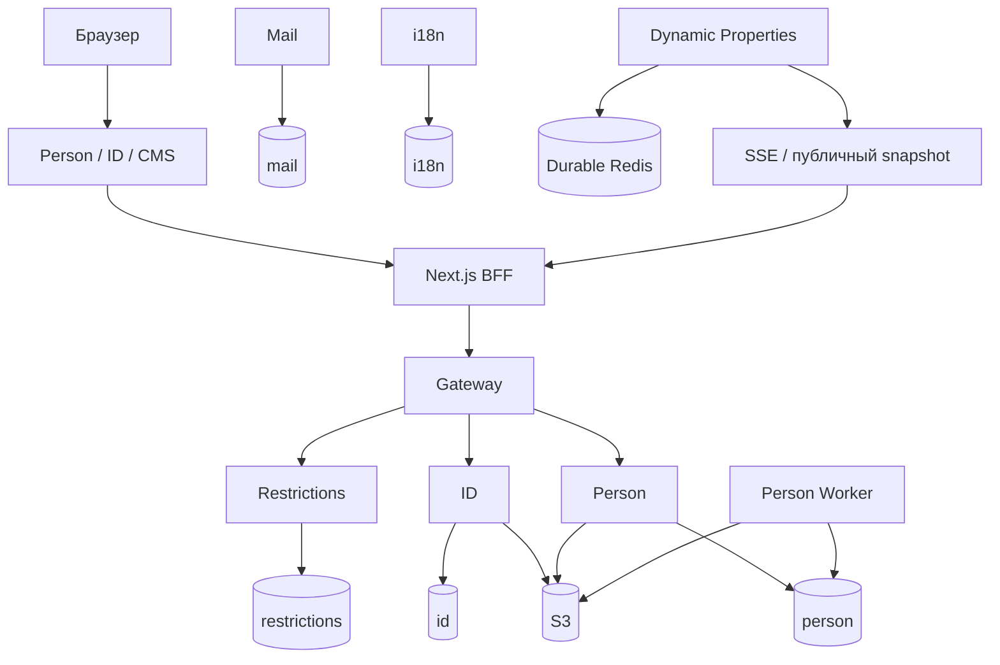

# Архитектура

[← Главная Wiki](Home.md) · [Эксплуатация →](Operations.md)

## Приложения и сервисы

| Компонент | Ответственность |
| --- | --- |
| `frontend/person` | Главная, поиск, каталог, страницы людей, контент и игровые события |
| `frontend/id` | Вход, регистрация, восстановление, профиль и сеансы |
| `frontend/person-admin` | CMS и модерация |
| `backend/id` | Аккаунты, OAuth, сессии, роли и аватары |
| `backend/person` | Персоны, контент, медиа, модерация и игровые API |
| `backend/gateway` | Проверки ограничений и проксирование к API |
| `backend/restrictions` | Блокировки, сроки и Redis-кэш |
| `backend/person-worker` | Фоновые расчёты, очистка файлов и игровой импорт |
| `backend/mail` | Постоянная очередь и SMTP-доставка |
| `backend/i18n` | Каталоги переводов, включая письма |

## Контракты и доступ к данным

OpenAPI в `app/contract/api/schema` задаёт серверные интерфейсы и Kotlin/TypeScript-клиенты. Generated-код создаётся при сборке. Сервер использует `com.persons`, Spring Boot, Spring Data JPA, Criteria API/specifications и Flyway; схема валидируется JPA.

Базы `id`, `person`, `restrictions`, `mail` и `i18n` разделены внутри одного PostgreSQL-кластера. `postgres` — служебная база. Redis для динамических свойств долговечен; Redis ограничений используется как кэш.

## Общие библиотеки

`frontend/libs`: UI, темы, i18n, редактор фотографий, Person domain и динамические свойства. `backend/libs`: ID-контекст, наблюдаемость запросов, динамические свойства и независимые клиенты OpenDota и Leetify. `frontend/assets` содержит брендовые материалы и шрифт.

## События и фоновые процессы

Письма и очистка объектов используют постоянные очереди. Аватары временно сохраняются в очереди БД до переноса в S3. Worker рассчитывает оценки и репутацию, обрабатывает сроки и очистку. Динамические свойства синхронизируются через Redis, ревизии, Pub/Sub и публичный SSE-поток. Игровой импорт использует lease, cursor, повторы и уникальные ключи, не удерживая SQL-транзакцию во время HTTP-запроса.

Подробнее: [фоновые задачи](../person/background-jobs.md), [интеграции](../game-integrations/ru.md), [Restrictions](../deployment/restrictions_ru.md).
