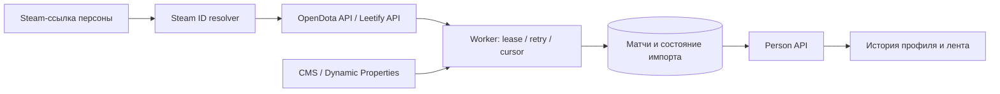
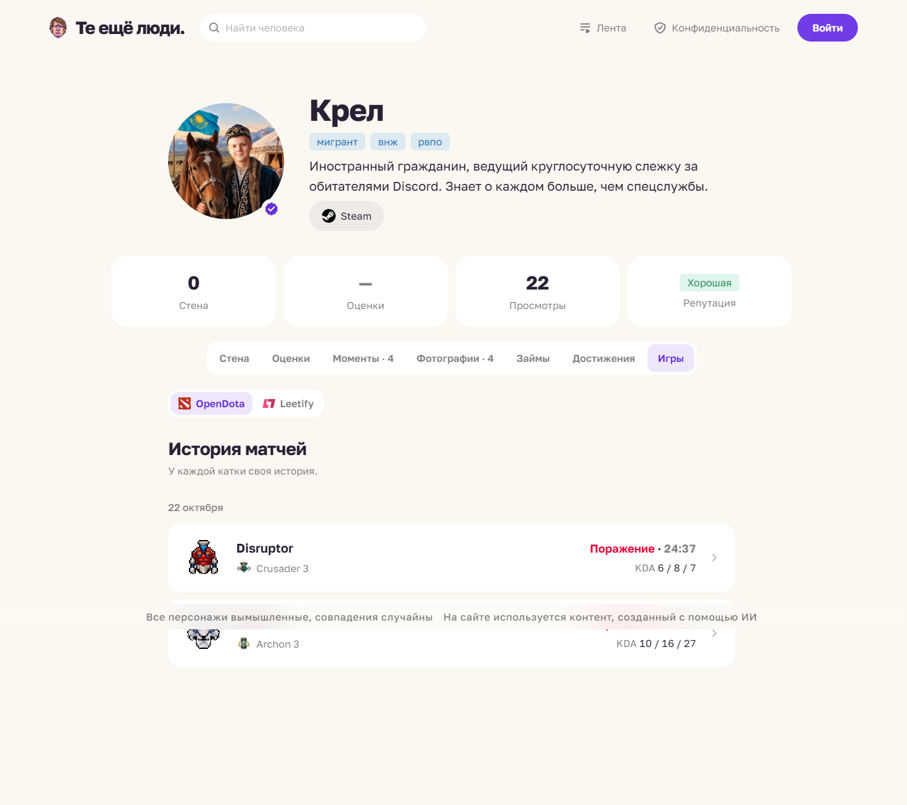

# Игровые интеграции

[← Главная Wiki](Home.md) · [Архитектура](Architecture.md)

В итоговом срезе есть два реализованных провайдера: **Dota 2 через OpenDota** и **CS2 через Leetify**. Оба используют Steam-привязку страницы, серверный импорт, постоянное состояние синхронизации, API истории и общие компоненты интерфейса.

## Dota 2 · OpenDota

`HttpOpenDotaClient` обращается к `/api/players/{id}/matches`, `/api/matches/{id}` и каталогам героев/предметов. `OpenDotaParser` разбирает JSON. В интерфейсе доступны герой, исход, KDA, счёт при наличии, длительность, ранг, урон, предметы и нейтральный слот; недоступные значения остаются опциональными.

Библиотека исторически называется `backend/libs/dotabuff-integration`, Kotlin-пакеты — `com.persons.dotabuff`. Но auto-configuration уже выбирает **HttpOpenDotaClient**. Старые имена классов, каталогов, ресурсов и ключи `games.dotabuff.*` сохранены для совместимости, а не обозначают текущий источник данных DotaBuff.

## CS2 · Leetify

`backend/libs/lettify-integration` — исходное имя каталога, Kotlin-пакеты — `com.persons.leetify`. Клиент читает профиль и матчи Leetify, worker сохраняет историю с lease и повторами. UI показывает карту, режим, результат, счёт, KDA и ранг; карточки, детали и attribution подключены через общий `GameHistory`.

Приватный или отсутствующий профиль обрабатывается отдельно, ошибки провайдера не заменяются демонстрационными матчами. Клиент поддерживает настройку API key; реальные реквизиты задаются только в частной runtime-конфигурации.

## Динамические настройки

| Ключи | Назначение |
| --- | --- |
| `games.dotabuff.enabled` | Включение синхронизации OpenDota; историческое имя ключа |
| `games.dotabuff.importFrom` | Нижняя дата импорта Dota 2 |
| `games.dotabuff.pollIntervalSeconds` | Интервал OpenDota |
| `games.leetify.enabled` | Включение синхронизации Leetify |
| `games.leetify.importFrom` | Нижняя дата импорта CS2 |
| `games.leetify.pollIntervalSeconds` | Интервал Leetify |

Исходные defaults не включают импорт автоматически. Реальное состояние production зависит от значений долговечного Redis. При восстановлении нужно возвращать его вместе с PostgreSQL.

## Надёжность и границы

Worker выбирает ограниченное число опубликованных Steam-профилей, использует lease и повторные попытки. Для Dota история читается порциями с cursor; повторные матчи не создаются. HTTP не удерживает долгую SQL-транзакцию. Внешние API, приватность профилей, лимиты запросов и доступность данных влияют на полноту истории. Тестовые fixtures и инструменты предпросмотра отделены от production.

Типизированные динамические свойства синхронизируются через Redis, ревизии, Pub/Sub, публичный snapshot и SSE. Исходная [подробная документация](../game-integrations/ru.md) сохраняет историю реализации DotaBuff и устройство свойств; для итогового выбора провайдеров источником истины служат `DotabuffAutoConfiguration`, `OpenDotaIntegration` и `LeetifyGameIntegration`.
