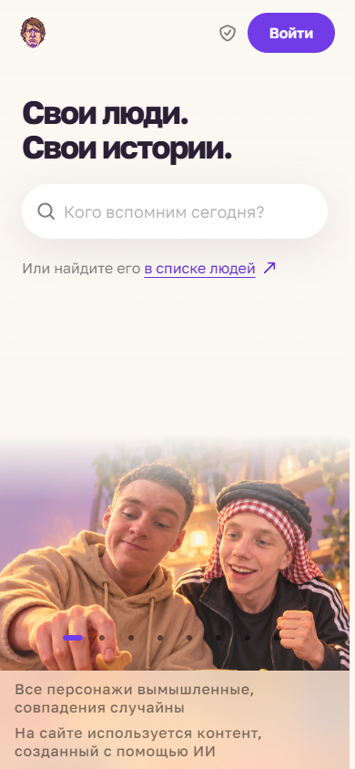

# Скриншоты действующего сайта

[← Главная Wiki](Home.md) · [Возможности](Features.md)

Сняты **25 октября 2026 года** с `https://kreeeeeel.ru` и `https://id.kreeeeeel.ru`. Использовался отдельный анонимный контекст браузера; необязательные cookie отклонены. Это снимки работающего сайта, не локального mock-стенда. URL и время съёмки записаны в [capture.json](../screenshots/capture.json).

## Главная

## Каталог

## Страница человека

## Игровой раздел

Состояние раздела зависит от доступной на момент съёмки истории профиля.

## Детали матча Dota 2

## CS2 · Leetify

## Тёмная тема

## ID

## На телефоне

CMS, личные сеансы, почта, доказательства владения и закрытые данные не снимались для публичной галереи. Лента перенаправляет анонимного посетителя в ID, поэтому отдельного скриншота её закрытого содержимого здесь нет.
